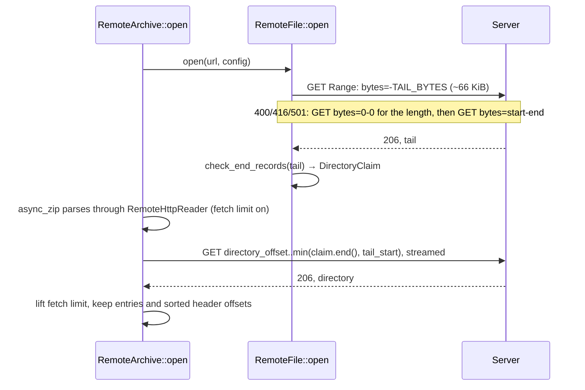

# How lazy-zip-core works

Internals for maintainers. To use the crate, read [core/README.md](../core/README.md).

## Modules

| File | Role |
|------|------|
| `core/src/http_reader.rs` | `RemoteFile` (the fetched tail and shared state), `RemoteHttpReader` (`AsyncRead + AsyncSeek`), `RangeStream` (one streamed, resumable range), `ReaderConfig`, retries |
| `core/src/archive_limits.rs` | Checks the end records in the tail before anything is parsed |
| `core/src/archive.rs` | `RemoteArchive` (directory read once, via `async_zip`), `open_entry`, `EntryReader` |
| `core/src/zip_explorer.rs` | Directory → flat tree, rejecting unsafe names |
| `core/src/safe_path.rs` | Entry name → safe path |
| `core/src/downloader.rs` | Selection plan, concurrent downloads through temp files |
| `core/src/error.rs` | `Error`, `ErrorKind` |

## Listing: usually 2 requests



The end records are read from the kept tail, never fetched again, so the server can't show the
check one record and the parser another. `DirectoryClaim::end` caps the claimed size at what the
claimed number of records could fill. While the fetch limit is on, only the claimed directory is
asked for in one request; anything else (records past the claim, a lying offset) goes in
`chunk_bytes` (1 MiB) requests, all counted against `MAX_DIRECTORY_BYTES + 2 * TAIL_BYTES`.

## Reading an entry: 1 or 2 requests

```text
open_entry(index)
  overlap checks against the next header offset or the directory (data_boundary)
  limit_to(min(boundary, header + 64 KiB)) ── request 1, streamed
  read the 30-byte local header: signature, encrypted flag, name and extra lengths
  limit_to(data_start)              (nothing past the header is consumed yet)
  compare the local name with the directory's raw name, skip the extra field
  limit_to(data_start + compressed_size)
  decoder(Take(compressed_size)) → Take(size + 1) → EntryReader (size and CRC)
                                   └─ request 2 from where request 1 ended, if the entry is longer
```

A refused entry costs at most the first request, which is dropped mid-body. An entry inside the
tail costs nothing.

## The reader

`RemoteHttpReader` has a position, an `end` set by `limit_to`, and a state:

- **Reads inside the tail** are copied from `RemoteFile::tail` and never change the state.
- **`Idle`**: a read starts a `RangeStream` from the position to `min(end, tail_start or len)`,
  or, while the fetch limit is on, to the directory's end or one chunk. Its size is reserved
  against the fetch limit first.
- **`Streaming { chunks, chunk, chunk_start, end }`**: reads copy from the current chunk, and poll
  the next one only when the position is exactly where the stream is. A seek anywhere else
  drops the state (closing the connection) and the next read goes back to `Idle`.
- `limit_to` lowers or raises `end` without touching the stream: bytes past `end` are never
  returned, and a later raise continues the same response.

`RangeStream::next_chunk` resumes a failed or short response with a new request from `pos`,
counting failures only since data last arrived. Every response goes through `Remote::request`.

## Defences

| Threat | Where |
|--------|-------|
| End records claiming huge allocations | `archive_limits.rs`: `check_end_records` (`MAX_ENTRIES`, `MAX_DIRECTORY_BYTES`, ZIP64 record inside the tail) |
| Different records for the check and the parser | `http_reader.rs`: `RemoteFile::open` keeps the tail; `poll_read` serves it from memory |
| Directory parsing fetching without limit | `http_reader.rs`: `Remote::reserve`, `FetchLimit`; `archive_limits.rs`: `DirectoryClaim::end` |
| Server ignoring Range | `http_reader.rs`: `open_tail`, `Remote::request` (refused before reading the body) |
| Wrong range, wrong file, file changed | `http_reader.rs`: `parse_content_range`, `Remote::request` (start, end, total length, `Validator`) |
| Compressed partial responses | `http_reader.rs`: `check_not_encoded`; requests send `Accept-Encoding: identity` |
| Bodies longer than asked for | `http_reader.rs`: `read_body`, `RangeStream::advance`, the `Content-Length` check in `Remote::request` |
| Stalls, drops, flaky servers | `http_reader.rs`: `ReaderConfig::build` (timeouts), `with_retries`, `RangeStream::next_chunk`, `RetryPolicy::delay`, `retry_after` |
| Headers leaking on redirect | `http_reader.rs`: `ReaderConfig::build` (custom policy unless only auth headers); `with_options` marks values sensitive |
| Signed URLs in errors | `error.rs`: `From<reqwest::Error>` (`without_url`); `downloader.rs`: `mark_as_downloaded` drops the query |
| Local header naming another file, overlapping or shared-offset entries | `archive.rs`: `RemoteArchive::from_reader` (`shared_offsets`), `data_boundary`, `open_entry` |
| Encrypted entries | `archive.rs`: `open_entry` (flag checked before any data is read) |
| Zip bombs, size and CRC lies | `archive.rs`: `EntryCheck::new` (ratio, stored sizes, LZMA), `EntryReader::read` |
| Unsafe names | `safe_path.rs`: `path_components`, `component_problem`; `zip_explorer.rs`: `build_tree` |
| Case collisions | `downloader.rs`: `plan_selection` |
| Symlinks redirecting writes | `safe_path.rs`: `ensure_within`, called by `downloader.rs`: `download_entry` |
| Partial or replaced files | `downloader.rs`: `download_entry` (temp file, `TempFileGuard`, rename) |
| Deep trees overflowing the stack | `safe_path.rs`: `MAX_DEPTH`; `zip_explorer.rs`: `build_tree`, `ScanResult::tree` are iterative |

## Compared with remotezip

[`remotezip`](https://pypi.org/project/remotezip/) subclasses Python's `zipfile.ZipFile` over a
Range-request file object. As of its current `master`:

| | remotezip | lazy-zip-core |
|---|---|---|
| Listing | 1 request for the last 64 KiB, 1 more for the rest of the directory (a `HEAD` first if suffix ranges are off) | The same, with ~66 KiB so a maximum-length comment fits; falls back to explicit ranges by itself |
| Directory size | Unbounded: `zipfile` reads whatever size the end record claims | Capped at 512 MiB and 5 million entries, checked before parsing |
| Reading an entry | 1 streamed request from its header to the next entry's header | 1 for entries under 64 KiB, otherwise 2 (header check, then the exact data) |
| Concurrency | One shared file object, so reads are serialized | Entries read and downloaded concurrently from one directory |
| Interrupted transfer | Fails | Retried with backoff, resumed from the exact byte |
| Timeouts, retries | None unless passed as `timeout=` or set up on a `requests` session | Connect and read timeouts, retries with `Retry-After` |
| Response checks | `Content-Range` must be present and well-formed | Exact range, same total length, same `ETag`/`Last-Modified`, no `Content-Encoding`, no extra bytes |
| Local header name, overlapping entries | From `zipfile` (the overlap check needs the CVE-2024-0450 fix: Python 3.12.2, 3.11.8 or later) | Always, plus entries sharing a header offset |
| Size and CRC | Output cut at the declared size, CRC checked at the end | Error on any size mismatch, CRC checked at the end, impossible ratios refused up front |
| Encrypted entries | `zipfile` asks for a password | Refused after the local header |
| Unsafe names on extract | `zipfile` rewrites them (`../a` → `a`) | Refused, on every OS, with case collisions |
| Writes | Directly to the destination | Temp file then rename; symlink escape refused; Mark-of-the-Web on Windows |
| URLs in errors | Included by `requests` | Removed |

## Who uses it

- **Desktop app** (`desktop/src-tauri/src/lib.rs`): `scan_zip` opens a `RemoteArchive`, returns
  `zip_explorer::scan`, and keeps the archive in `LastScan`, keyed by URL and headers.
  `start_download` reuses it with `download_from` when both match, otherwise `download_batch`, on
  a spawned task with a `CancellationToken` per job.
- **Python bindings** (`python/src/lib.rs`): each `RemoteZip` opens one `RemoteArchive` and keeps
  it with its `ReaderConfig`. `read`, `open` and `testzip` use `open_entry`, `extractall` uses
  `plan_selection` and `download_from`, and every call blocks on a shared Tokio runtime with the
  GIL released.
